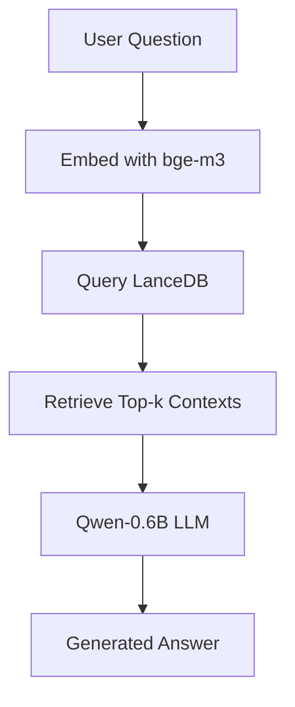

# RAG Pipeline: bge-m3 + LanceDB + Qwen-0.6B

## Overview
This project implements a modular Retrieval-Augmented Generation (RAG) pipeline using:
- **Embedding model:** bge-m3 (Hugging Face)
- **Vector DB:** LanceDB
- **LLM:** Qwen-0.6B (Hugging Face)
- **Dataset:** Instructional QA JSONs (see below)

## Features
- Loads and merges multiple instructional QA datasets
- Preprocesses into `{instruction, input, output}`
- Embeds (instruction + input) with bge-m3, stores in LanceDB
- RAG query flow: user question → embed → retrieve top-k → Qwen-0.6B with context → response
- Modular code: easy to swap models/DBs
- CLI interface
- Logging for latency and retrieval metadata
- Lightweight, local/offline friendly

## File Structure
- `main.py` — CLI entry point
- `embedding.py` — Embedding logic
- `model.py` — Qwen LLM wrapper
- `rag.py` — Retrieval and generation logic

## Setup
1. **Clone repo & install dependencies:**
   ```bash
   git clone <repo-url>
   cd Rag_pipe
   pip install -r requirements.txt
   ```
2. **Download datasets:** (auto-downloaded on first run)

3. **Run CLI:**
   ```bash
   python main.py --question "How do I import data?"
   ```

## Datasets
- [Data ImportExport.json](https://huggingface.co/datasets/Sachin-NK/GRASS_sample/resolve/main/Data%20ImportExport.json)
- [Fundamentals and Core Concepts.json](https://huggingface.co/datasets/Sachin-NK/GRASS_sample/resolve/main/Fundamentals%20and%20Core%20Concepts.json)
- [Installation and Setup.json](https://huggingface.co/datasets/Sachin-NK/GRASS_sample/resolve/main/Installation%20and%20Setup.json)
- [Raster Analysis.json](https://huggingface.co/datasets/Sachin-NK/GRASS_sample/resolve/main/Raster%20Analysis.json)
- [Troubleshooting and Error Resolutio.json](https://huggingface.co/datasets/Sachin-NK/GRASS_sample/resolve/main/Troubleshooting%20and%20Error%20Resolutio.json)
- [Vector Operations.json](https://huggingface.co/datasets/Sachin-NK/GRASS_sample/resolve/main/Vector%20Operations.json)
- [Visualization and Cartography.json](https://huggingface.co/datasets/Sachin-NK/GRASS_sample/resolve/main/Visualization%20and%20Cartography.json)

## Requirements
- Python 3.8+
- [LanceDB](https://lancedb.github.io/lancedb/)
- [transformers](https://huggingface.co/docs/transformers/index)
- [sentence-transformers](https://www.sbert.net/)
- [huggingface_hub](https://huggingface.co/docs/huggingface_hub/index)
- [Qwen-0.6B](https://huggingface.co/Qwen/Qwen-0.5B)
- [bge-m3](https://huggingface.co/BAAI/bge-m3)

## Architecture


## Swapping Models/DBs
- To swap embedding/LLM/vector DB, update `embedding.py`, `model.py`, or `rag.py` as needed (modular interfaces).

## Logging
- Logs query latency and top match metadata to stdout. 